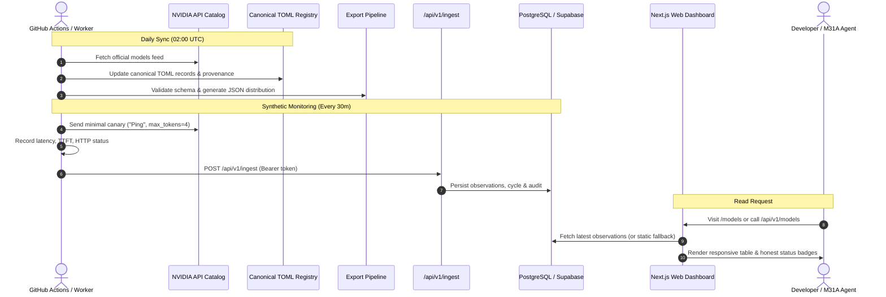

# System Architecture & Technical Specifications

## 1. Architectural Principles

1. **Canonical TOML as Single Source of Truth**:
   The registry lives in `registry/models/*.toml` and `registry/index.toml`. The Next.js application does not maintain hardcoded models. All JSON distribution artifacts (`src/data/catalog.json`, `public/data/catalog.json`, `public/data/m31a-models.json`) are generated deterministically by `scripts/export_catalog.ts` after strict Zod schema validation.

2. **Non-Conflating Observability**:
   - Provider-published metrics are explicitly labeled as provider metrics when documented.
   - Synthetic canaries are explicitly labeled as observations from our monitoring system.
   - Provider-wide GPU load, cluster queue depth, or demand is never fabricated or inferred.
   - Upstream HTTP 401/403 (authentication anomalies) or HTTP 429 (rate limits) trigger operator alerts and are classified independently; they **never** mark a healthy model as "unavailable".

3. **Safe Ingestion & Zero Secret Leakage**:
   - The ingestion Route Handler (`/api/v1/ingest`) compares bearer tokens using constant-time `crypto.timingSafeEqual`.
   - Incoming payloads are strictly validated against `IngestionPayloadSchema`.
   - Model IDs are verified against known canonical entries before persistence to prevent SSRF and injection.
   - Timestamps must fall within a ±15 minute clock-skew window.

4. **Graceful Static Fallback**:
   When `DATABASE_URL` is omitted, the application operates in static catalog-only mode. It displays honest status indicators (`Unknown` or `Catalog Only`) and never fabricates historical graphs or silently pretends a database write succeeded.

---

## 2. Data Flow Architecture

---

## 3. Database Schema Design (Drizzle ORM)

### `model_observations`
- `id` (SERIAL PRIMARY KEY)
- `model_id` (TEXT NOT NULL, Indexed)
- `status` (TEXT NOT NULL: operational, degraded, unavailable, unknown, stale, catalog_only, downloadable_only)
- `result_category` (TEXT NOT NULL: success, rate_limit, http_error, timeout, invalid_response, network_error, auth_error)
- `timestamp` (TIMESTAMPTZ NOT NULL, Indexed)
- `latency_ms` (DOUBLE PRECISION NOT NULL)
- `ttft_ms` (DOUBLE PRECISION)
- `tokens_out` (INTEGER)
- `tokens_per_sec` (DOUBLE PRECISION)
- `failure_category` (TEXT)
- `error_message` (TEXT, sanitized)
- `http_status` (INTEGER)
- `provenance` (TEXT DEFAULT 'm31a_synthetic_worker')
- `run_id` (TEXT, Indexed)

### `status_transitions`
- `id` (SERIAL PRIMARY KEY)
- `model_id` (TEXT NOT NULL, Indexed)
- `prev_status` (TEXT NOT NULL)
- `new_status` (TEXT NOT NULL)
- `timestamp` (TIMESTAMPTZ NOT NULL)
- `reason` (TEXT NOT NULL)
- `observation_id` (INTEGER)

### `monitoring_cycles`
- `id` (TEXT PRIMARY KEY)
- `started_at` (TIMESTAMPTZ NOT NULL)
- `finished_at` (TIMESTAMPTZ)
- `models_attempted` (INTEGER NOT NULL)
- `probes_succeeded` (INTEGER NOT NULL)
- `probes_failed` (INTEGER NOT NULL)
- `budget_tokens_consumed` (INTEGER NOT NULL)
- `cycle_status` (TEXT NOT NULL)

### `ingestion_audits`
- `id` (TEXT PRIMARY KEY)
- `run_id` (TEXT NOT NULL)
- `accepted_records` (INTEGER NOT NULL)
- `rejected_records` (INTEGER NOT NULL)
- `timestamp` (TIMESTAMPTZ NOT NULL)
- `client_identity` (TEXT NOT NULL)
- `diagnostics` (TEXT)
